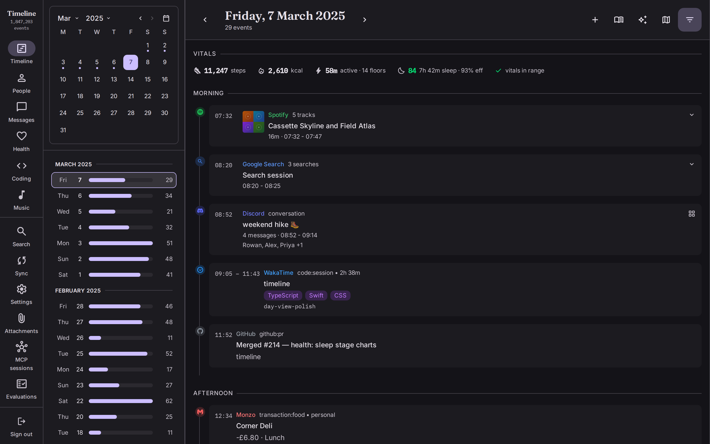
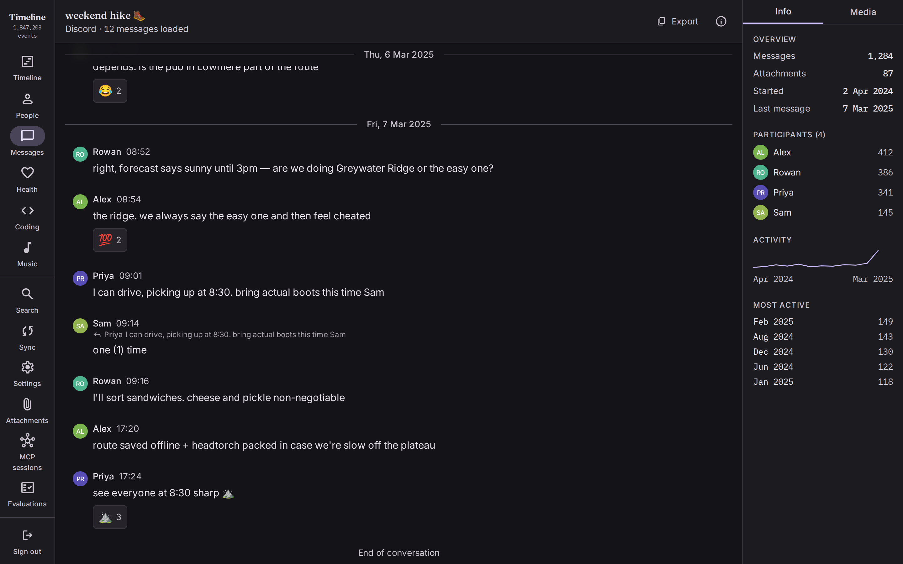
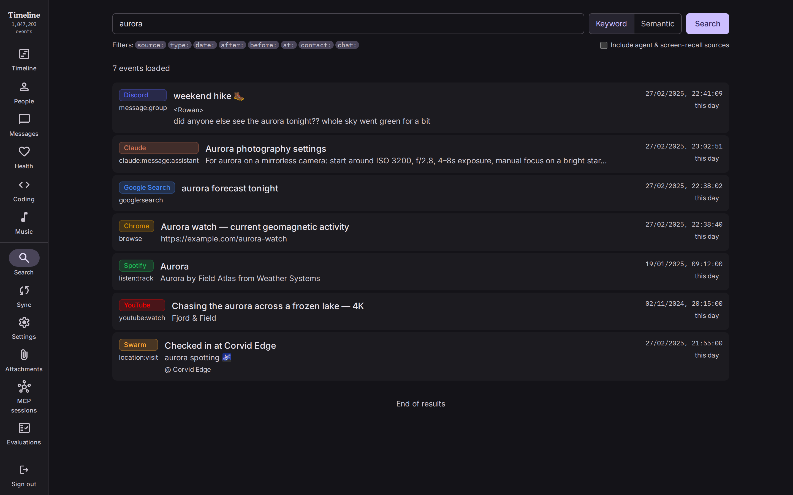
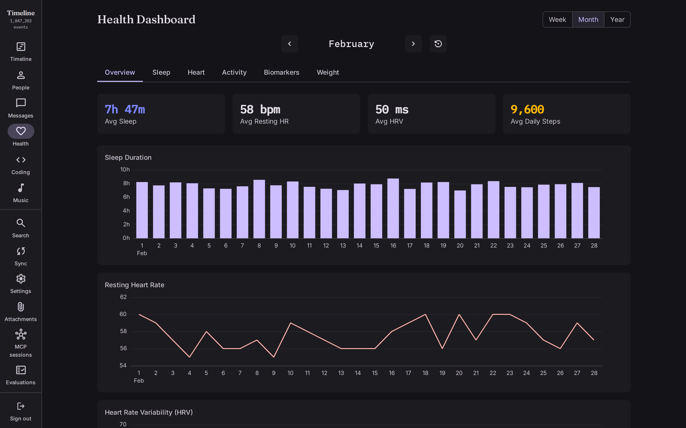
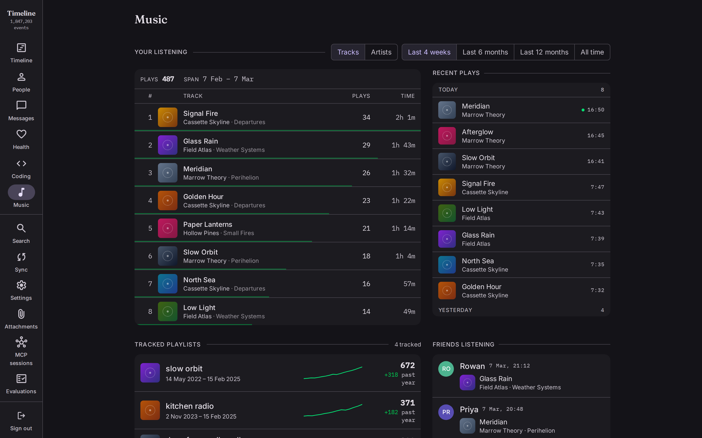

# Timeline

A self-hosted, searchable timeline of your life. Timeline indexes exports from all your digital services into a unified SQLite database with a web interface and AI-powered querying.



| | |
|---|---|
|  |  |
|  |  |

*Screenshots show fictional demo data, generated by `web/e2e/showcase.spec.ts` with `./scripts/test-browser.sh --config=playwright.showcase.config.ts`.*

## Overview

Timeline serves two purposes:

1. **A practical tool** for archiving and querying your digital life—messages, listening history, location, transactions, health metrics, coding activity, and more—across 30+ sources in a single searchable timeline.

2. **A research platform** for experimenting with AI on personal data: building datasets, testing retrieval strategies, and exploring memory architectures.

Features include:
- **Web app** with search, conversation browsing, day views, and contact management
- **AI chat** for natural language queries ("What was I listening to during my trip to Japan?")
- **MCP server** for Claude Desktop integration
- **Automated sync** from API-based sources (Monzo, Trakt, Google Health, GitHub, etc.)
- **Full-text search** via SQLite FTS5 or Meilisearch

## Research Directions

- Fine-tuning on personal conversation history
- RAG over the timeline for contextual retrieval
- Long-term memory architectures (Titans, etc.) - moving beyond pure retrieval to learned/compressed memory

## Quick Start

```bash
bun install

# Import data from an export
bun run src/parsers/spotify.ts ./imports/spotify my-account

# Run the web app (API + frontend)
bun run dev

# Or run as a service with automated syncing (AUTH_PASSWORD is required outside dev)
AUTH_PASSWORD='choose-a-password' \
bun run service
```

`bun run dev` starts the local API without authentication by default, ignoring
the password in `~/.config/timeline/env`. To exercise login, run
`AUTH_PASSWORD='dev-password' bun run dev`; a password loaded from a local `.env`
also enables authentication. Use `AUTH_PASSWORD='' bun run dev` to explicitly
disable it locally. When using `API_HOST` or `TIMELINE_API_TARGET`, the remote
API's authentication still applies.

## Supported Data Sources

| Source | Type | Events |
|--------|------|--------|
| Facebook | Messages, posts | File export |
| Discord | DMs, group chats | Local DB import |
| Google Search | Search history | Takeout |
| Spotify | Listening history | Export + API |
| Spotify Friends | Friends' activity | API (unofficial) |
| Claude Code | Session transcripts | Local files |
| Amp | AI assistant sessions | API |
| OpenCode, Conductor | AI assistant sessions | Local files |
| YouTube | Watch history, likes, searches | Takeout |
| Skype | Messages | Export |
| Google Fit | Activity, sleep | Takeout |
| Google Location | Place visits, transit | Takeout / Timeline.json |
| Reddit | Posts, comments, messages | Export |
| WakaTime | Coding sessions | API / Export |
| Monzo | Transactions | OAuth2 API |
| Chrome | Browsing history | Takeout |
| SMS/Calls | Texts, call logs | SMS Backup & Restore app |
| Claude | Chat history | claude.ai export |
| Trakt | Watch history | OAuth2 API |
| ChatGPT | Chat history | Export |
| GitHub | Commits, activity | API |
| Fitbit | Sleep, readiness, stress, HRV | Google Takeout |
| Google Health | Sleep, HRV, heart rate, SpO2, activity, weight | OAuth2 API |
| Google Calendar | Events | Takeout |
| LinkedIn | Messages, connections | Export |
| Google Keep | Notes | Takeout |
| Google Chat | Messages | Takeout |
| Google Play Store | App installs | Takeout |
| Thriva | Blood test biomarkers | API |
| Instagram | Messages, posts | Export |
| Minecraft | Server logs | Log files |

## Architecture

```
┌─────────────────────────────────────────────────────────────┐
│  Web App (SolidJS)                                          │
│  Search · Conversations · Day View · Contacts · AI Chat     │
└─────────────────────────────────────────────────────────────┘
                              │
┌─────────────────────────────▼───────────────────────────────┐
│  API Server (Hono)                                          │
│  REST endpoints · Streaming chat · Query execution          │
└─────────────────────────────────────────────────────────────┘
                              │
        ┌─────────────────────┼─────────────────────┐
        ▼                     ▼                     ▼
┌───────────────┐   ┌─────────────────┐   ┌─────────────────┐
│  timeline.db  │   │  app-state.db   │   │  Meilisearch    │
│  Events, FTS  │   │  Chats, Logs    │   │  (optional)     │
└───────────────┘   └─────────────────┘   └─────────────────┘
```

**Service mode** adds:
- Sync scheduler (runs API sources at configured intervals)
- Inbox watcher (auto-imports new export files)
- Meilisearch incremental sync

## Database Schema

All events normalized to a single `events` table:

| Column | Purpose |
|--------|---------|
| `source`, `source_id`, `source_account` | Track origin |
| `type` | Classification (listen:track, message, location:visit, etc.) |
| `timestamp`, `end_timestamp`, `duration_ms` | Temporal data |
| `title`, `content` | Searchable text (FTS5 indexed) |
| `latitude`, `longitude`, `location_name` | Location |
| `people`, `tags` | JSON arrays |
| `raw_data` | Original export data preserved |

## MCP Server

Exposes timeline data to Claude Desktop:

```bash
bun run mcp
```

Tools include `search_timeline`, `get_events`, `search_by_contact`, `run_sql`, and more.

## Development

### Testing

Run `./test.sh` before pushing. Screenshot comparisons run in the same Ubuntu
Playwright container locally and in CI. CI runs each chart resize sweep directly
on Ubuntu 24.04 with the locked Chromium version and its system dependencies.
Install Bun and Docker (Docker Desktop on macOS), and start Docker before running
the suite. Apple Silicon Macs use the same `linux/amd64` image through emulation.

The full suite runs backend tests, frontend tests, and type checks alongside the
browser checks; Playwright supplies the production build check. `./test.sh unit`
runs the unit checks without browsers or a production build. `./test.sh backend` and
`./test.sh frontend` run those checks separately for hosted CI. Each check reports
its duration and prints its log on failure. PR and trusted CI run browser projects
on separate Linux runners, while trusted CI keeps backend and app checks on macOS.

PR chart sweeps check representative widths and layout boundaries. Trusted CI on
main and local runs retain the exhaustive sweep. Set `PLAYWRIGHT_CHART_SWEEP=smoke`
to reproduce the PR coverage locally; the default is `full`. Dense health screenshots
cover compact, desktop, and wide windows.

To run only browser tests or update baselines after an intentional visual change:

```bash
./scripts/test-browser.sh
./scripts/test-browser.sh --update-snapshots
# Playwright arguments work too:
./scripts/test-browser.sh app.spec.ts --grep 'renders the app'
# Match one of the browser CI jobs:
./test.sh browser --project=chart-month
```

The image uses the locked Playwright version and the project's Bun version.
Linux dependencies are isolated from host `node_modules`; updated screenshots,
`web/playwright-report/`, and `web/test-results/` are written into the checkout.
Inspect updated screenshots before committing, then rerun without
`--update-snapshots` to verify them.

For native browser behavior checks without Docker, use
`PLAYWRIGHT_IGNORE_SNAPSHOTS=1 ./test.sh browser`. This skips visual comparisons
and is an optional local override; CI always compares the Linux screenshots.

### Relocatable service artifact

Build the service, scheduler/database workers, web frontend, pinned Bun
runtime, native runtime dependencies, and version metadata into an artifact
that runs without the source checkout:

```bash
bun run build:service
./dist/timeline-service/bin/timeline-service
```

`tools/timeline-app/build.sh` embeds this artifact in `Timeline.app`; the
installed LaunchAgent runs that copy rather than the checkout. Exercise the
standalone packaged boundary from a temporary working directory with:

```bash
./scripts/smoke-service-artifact.sh
```

### Commit Style

This project uses scoped commits:

```
<scope>: <description>
```

**Scope**: The subsystem touched, e.g., `contacts`, `spotify`, `api`. Prefer deriving it from existing repo history.

**Examples**:
- `contacts: add identity suggestions to UI`
- `linkedin: strip name prefix from identities`
- `docs: document /status.md endpoint`

**Guidelines**:
- Keep the title under 50 characters (hard limit: 72)
- Each commit should be a complete, working change—don't commit half a feature

## Philosophy

- **Local-first**: Your data stays on your machine
- **Raw preservation**: Original export data kept for future reprocessing
- **Single schema**: One unified events table, not per-source silos
- **Extensible**: Add new parsers without schema changes

## Documentation

See `AGENTS.md` for detailed setup instructions, parser commands, API reference, and deployment guide.
Running the service on a macOS host: `docs/macos-host.md`.
Contributing: `CONTRIBUTING.md`. Reporting security issues: `SECURITY.md`.
Embeddings & vector search: `docs/embeddings.md`.
